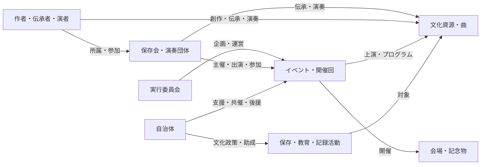
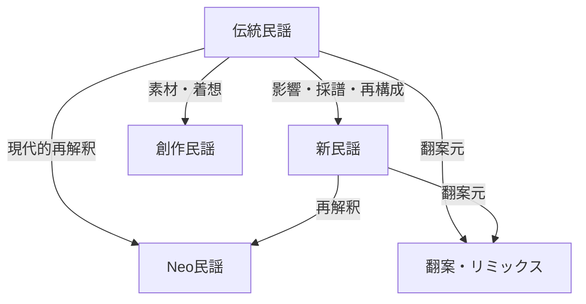

# 文化エコシステム可視化仕様

## 目的

1919のMarkdownレコードから、民謡・新民謡・Neo民謡・団体・イベント・実行委員会・自治体・場所の関係を可視化する。可視化はデータモデルの検証手段でもあり、単なる広報用図版ではない。

## 初期ネットワークモデル



## 曲の系譜・再創造モデル



矢印は分類間の固定的な進化段階を意味しない。作品ごとの出典・制作意図・影響関係を記録するための概念図である。

## MVP画面

### 1. 全体ネットワーク
- ノード：曲・団体・個人・イベント・委員会・自治体・場所
- エッジ：伝承、所属、主催、共催、出演、支援、開催、派生
- ノードを選択すると該当IDのMarkdownレコードへ遷移
- 関係の確認状態を色・線種・凡例で表示
- 未確認エッジは確定エッジと視覚的に区別

### 2. 団体詳細
- 団体が関わる曲・芸能の一覧
- 主催・出演するイベント
- 所属する個人・構成団体
- 活動履歴・関連自治体
- 年代別の関与状況

### 3. イベント詳細
- イベントシリーズと開催回の関係
- 実行委員会・主催・共催・後援・協賛
- 出演団体・出演者・プログラム曲
- 会場・開催日・関連自治体
- 過年度との比較

### 4. 曲・文化資源詳細
- 別名・分類・成立情報
- 伝承・普及・演奏する団体
- 作者・伝承者・研究者
- 関連イベント・地域
- 原曲・翻案・新民謡・Neo民謡との派生関係

## Markdownから抽出する最小メタデータ

各レコードの冒頭に以下を記述する。YAML front matterを推奨する。

```yaml
---
record_id: cr-example-song
entity_type: cultural_resource
name: サンプル民謡
record_status: active
source_status: preliminary
related_ids:
  - org-example-group
  - evt-example-festival-2026
---
```

関係は本文に人間可読な一覧として記述し、後に機械可読なYAMLブロックへ統一する。IDが存在しない相手は仮IDを発行せず、名称と確認状態を記録する。

## MVPの実装順

1. MarkdownのID・メタデータ規約を確定
2. レコード間リンクと関係役割の抽出
3. ノード・エッジJSONの生成
4. Mermaidによる静的な関係図を自動生成
5. フィルタ・検索・ノード選択付きのインタラクティブ表示
6. 地図・年表・イベントシリーズ表示へ拡張

## 表示上の注意

- ノード数・接続数は文化的価値の点数ではない。
- 情報量が多い団体ほど大きく見える偏りに注意する。
- 出典の強さ、確認状態、最終確認日を閲覧できるようにする。
- 個人情報・権利・非公開情報を可視化対象から除外できるようにする。
